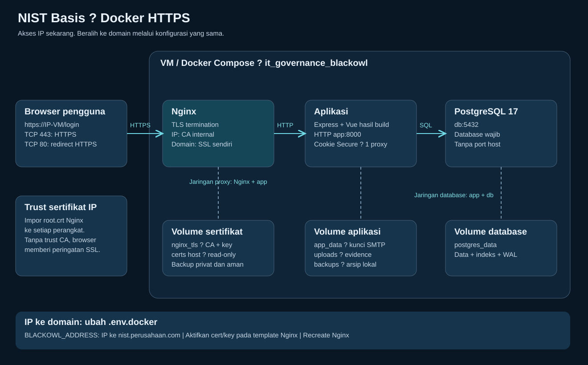
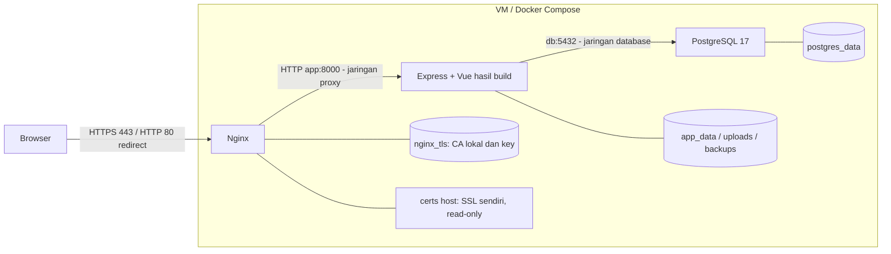

# Docker HTTPS dengan Nginx

Deployment Docker menggunakan **Nginx** sebagai reverse proxy HTTPS.
Hanya Nginx membuka port host 80/443. HTTP diarahkan ke HTTPS; backend dan
PostgreSQL tidak membuka port host. Cookie sesi tetap Secure.

## Arsitektur





TLS berakhir di Nginx; koneksi ke backend menggunakan HTTP jaringan Docker.
Nginx mempertahankan Host dan mengganti forwarded headers dari klien. Aplikasi
mempercayai satu hop proxy. Jangan membuka backend langsung, menambahkan proxy
lain atau memasukkan container tidak tepercaya ke jaringan proxy tanpa meninjau
konfigurasi trust. Database terpisah dari jaringan Nginx; koneksi DB tidak memakai TLS.

## Instalasi baru: akses IP VM

1. Pasang Docker dengan Compose v2 (Linux containers). Salin docker.env.example
   ke .env.docker **hanya pada instalasi baru**. Isi BLACKOWL_DB_PASSWORD dan:

   ```dotenv
   BLACKOWL_ADDRESS=192.168.130.12
   BLACKOWL_BIND_IP=0.0.0.0
   ```

   Ganti dengan IPv4 VM yang dapat dijangkau pengguna. ADDRESS hanya IPv4/domain,
   tanpa skema, path atau port; IPv6 belum didukung skrip TLS lokal ini.
   BIND_IP adalah interface host, bukan alamat pada sertifikat.
2. Izinkan TCP 80/443 dari jaringan pengguna. Jangan membuka 5000/8000/5432.
   Pastikan port tidak dipakai layanan lain. Docker Linux dapat melewati UFW
   biasa; gunakan firewall yang sesuai backend Docker atau ACL jaringan.
3. Jalankan dari root project:

   ```text
   docker compose --env-file .env.docker config --quiet
   docker compose --env-file .env.docker up -d --build
   docker compose --env-file .env.docker ps
   docker compose --env-file .env.docker logs --tail 100 nginx app db
   ```

4. Lakukan trust CA di bawah, kemudian buka https://192.168.130.12/login.
   Instalasi baru membuat admin / admin saat tabel akun kosong; segera ganti
   password. Akun dan data lama tetap dipertahankan.

## Agar HTTPS IP dipercaya browser

Image Nginx kustom memasang OpenSSL dan menjalankan skrip 15-local-tls.sh.
Mode default membuat CA lokal (10 tahun) dan sertifikat server ber-SAN IP/domain
(365 hari) pada volume nginx_tls, bukan sertifikat publik tepercaya otomatis.
Browser memperingatkan sampai CA lokal dipercaya setiap perangkat pengguna.

Ekspor **hanya root.crt** dari VM tepercaya:

```text
docker compose --env-file .env.docker cp nginx:/etc/nginx/generated/root.crt ./nginx-root.crt
```

- Windows, untuk pengguna saat ini: jalankan
  `certutil -user -addstore Root .\nginx-root.crt`.
- Ubuntu/Debian: salin sebagai /usr/local/share/ca-certificates/blackowl-nginx.crt,
  lalu jalankan `sudo update-ca-certificates`.
- Browser dengan trust store sendiri mungkin memerlukan impor CA melalui
  pengaturan browser atau kebijakan organisasi.

Distribusikan CA melalui kanal administrator tepercaya. Jangan membagikan root.key,
server.key atau volume nginx_tls. CA yang dipercaya dapat menerbitkan sertifikat
lain, sehingga private key CA harus diamankan. Backup nginx_tls dengan aman;
kehilangan CA memerlukan distribusi trust baru.

Skrip menggunakan kembali CA dan sertifikat yang masih valid; saat container
mulai ulang, sertifikat server diperbarui jika tersisa kurang dari 30 hari atau
ADDRESS berubah. **Tidak ada scheduler renewal saat container terus berjalan**:
pantau masa berlaku dan lakukan recreate terencana sebelum kedaluwarsa. CA
kedaluwarsa/tidak lengkap membuat startup gagal, tanpa mengganti CA diam-diam.
Rotasi CA perlu dilakukan terencana dan didistribusikan ke semua klien.

## SSL sendiri untuk domain

Contoh tersedia sebagai komentar di
[template Nginx](../deploy/nginx/templates/default.conf.template).

1. Siapkan file PEM pada host:

   ```text
   deploy/nginx/certs/fullchain.pem
   deploy/nginx/certs/private.key
   ```

   fullchain.pem berisi sertifikat domain terlebih dahulu, lalu intermediate
   certificate. Private key harus pasangan yang benar, tanpa passphrase untuk
   startup noninteraktif, dan dilindungi hak akses file. PFX/P12 perlu diekspor
   ke PEM lebih dahulu. Folder certs dikecualikan dari Git dan kedua build context;
   tidak disalin ke image. Mount ke /etc/nginx/certs sudah read-only di Compose.
2. Atur domain pada .env.docker, pertahankan password database:

   ```dotenv
   BLACKOWL_ADDRESS=nist.perusahaan.com
   ```

3. Di deploy/nginx/templates/default.conf.template, comment **kedua** directive
   sertifikat default lalu aktifkan kedua baris SSL sendiri:

   ```nginx
   # ssl_certificate /etc/nginx/generated/server.crt;
   # ssl_certificate_key /etc/nginx/generated/server.key;
   ssl_certificate /etc/nginx/certs/fullchain.pem;
   ssl_certificate_key /etc/nginx/certs/private.key;
   ```

   Jangan mengaktifkan kedua pasangan sekaligus. Mode manual tidak membuat atau
   mengubah file sertifikat Anda; sertifikat default lama boleh tetap di volume.
4. Arahkan DNS domain ke IP VM. Untuk LAN gunakan DNS internal atau hosts pada
   setiap perangkat (Windows: C:\Windows\System32\drivers\etc\hosts;
   Linux: /etc/hosts). Contoh baris hosts:

   ```text
   192.168.130.12 nist.perusahaan.com
   ```

   Akses melalui domain yang tercakup SAN sertifikat, bukan IP. Sertifikat CA
   publik tepercaya tidak memerlukan CA lokal Nginx; CA perusahaan harus dipercaya
   klien. SSL manual tidak mengharuskan aplikasi terbuka ke internet.
5. Build proxy dan validasi sebelum menerapkan:

   ```text
   docker compose --env-file .env.docker build nginx
   docker compose --env-file .env.docker run --rm --no-deps nginx nginx -t
   ```

   Perintah validasi menjalankan entrypoint/template resmi dan skrip TLS lalu
   nginx -t; tidak membuka port atau menjalankan app/database. Pada mode lokal
   perintah ini dapat membuat/memperbarui sertifikat di nginx_tls. Jika berhasil:

   ```text
   docker compose --env-file .env.docker up -d --force-recreate nginx
   docker compose --env-file .env.docker logs --tail 100 nginx
   curl -I https://nist.perusahaan.com/login
   ```

   Pada Windows gunakan curl.exe. Jika DNS belum diubah:
   `curl --resolve nist.perusahaan.com:443:192.168.130.12 -I https://nist.perusahaan.com/login`.
   Untuk CA perusahaan gunakan trust store/--cacert CA yang benar, tanpa -k.

Perpanjangan SSL sendiri dilakukan manual: ganti fullchain/key di host,
validasi lalu recreate Nginx dan periksa masa berlaku yang disajikan. Tidak perlu
rebuild image hanya untuk perubahan sertifikat/template/environment.
Nginx pada setup ini **tidak menyediakan ACME otomatis**; integrasi Certbot/ACME
belum disertakan. Untuk kembali ke CA lokal, aktifkan pasangan generated,
comment pasangan certs, ubah ADDRESS bila perlu dan recreate proxy.

## Beralih dari IP ke domain

Ubah BLACKOWL_ADDRESS ke domain, siapkan DNS dan aktifkan SSL sendiri seperti
bagian sebelumnya. Tidak perlu perubahan source frontend/backend. Login ulang
pada domain baru karena cookie IP tidak dipindahkan. Setup ini hanya melayani
satu alamat yang dikonfigurasi. Mengubah ADDRESS saja tetap memakai CA lokal,
bukan otomatis mendapat sertifikat publik.

## Upgrade dari Docker HTTP lama

Backup database, evidence, kunci SMTP, konfigurasi dan private key terlebih dahulu.
Pertahankan .env.docker, password database, nama project it_governance_blackowl,
dan volume postgres_data/app_data/uploads/backups. Jangan menyalin template
ke .env.docker lama. BLACKOWL_TLS, BLACKOWL_PORT dan BLACKOWL_COOKIE_SECURE
lama tidak lagi dipakai. Siapkan ADDRESS dan file/template SSL sesuai mode.

Jalankan dari folder project:

```text
docker compose --env-file .env.docker up -d --build
docker compose --env-file .env.docker ps
```

Jangan menggunakan down -v. Nginx menambah volume nginx_tls untuk mode lokal.
Untuk migrasi memakai SSL sendiri, salin sertifikat/key yang memang Anda miliki
ke folder Nginx secara aman.

## Verifikasi dan diagnosis

```text
docker compose --env-file .env.docker run --rm --no-deps nginx nginx -t
curl -I http://192.168.130.12/login
curl --cacert ./nginx-root.crt -I https://192.168.130.12/login
```

Harapkan HTTP 308 ke HTTPS dan HTTPS 200 tanpa bypass TLS. Untuk SSL sendiri,
gunakan URL domain dan trust issuer yang benar. Periksa login/logout, cookie
Secure/HttpOnly, simpan data, evidence, backup dan progress scan pada instalasi uji.
Hanya Nginx mempublikasikan 80/443 pada compose ps.

| Gejala | Periksa |
| --- | --- |
| Unknown CA | Trust CA lokal/perusahaan yang benar pada klien. |
| Name mismatch | Domain/IP pada URL harus tercakup SAN sertifikat. |
| Nginx gagal mulai | Log, format PEM, pasangan key/chain, izin file, masa berlaku CA. |
| Port conflict | Layanan lain masih memakai 80/443. |
| 502 | Health app/db, jaringan Docker dan startup aplikasi. |
| 504 / transfer berhenti | Proxy memakai timeout idle 3600 detik; cek koneksi dan app. |
| Login/simpan ditolak | Host/origin harus konsisten HTTPS; jangan menambah hop proxy tanpa review. |

Proxy tidak membatasi ukuran body (client_max_body_size 0), menonaktifkan request
buffering dan response buffering untuk dump besar dan progress NDJSON. Batas
upload/permission per fitur aplikasi tetap berlaku. Transfer yang idle lebih dari
3600 detik dapat terputus. Sesuaikan timeout jika kebutuhan nyata mengharuskannya.

Referensi: [Nginx HTTPS](https://nginx.org/en/docs/http/configuring_https_servers.html)
dan [proxy module](https://nginx.org/en/docs/http/ngx_http_proxy_module.html).

Verifikasi lokal dicatat pada AI_HANDOFF.md. Docker/Nginx/OpenSSL CLI tidak
tersedia di sesi ini; image build, nginx -t, penerbitan sertifikat dan konektivitas
VM belum diuji langsung. Tidak membaca .env atau data operasional.
